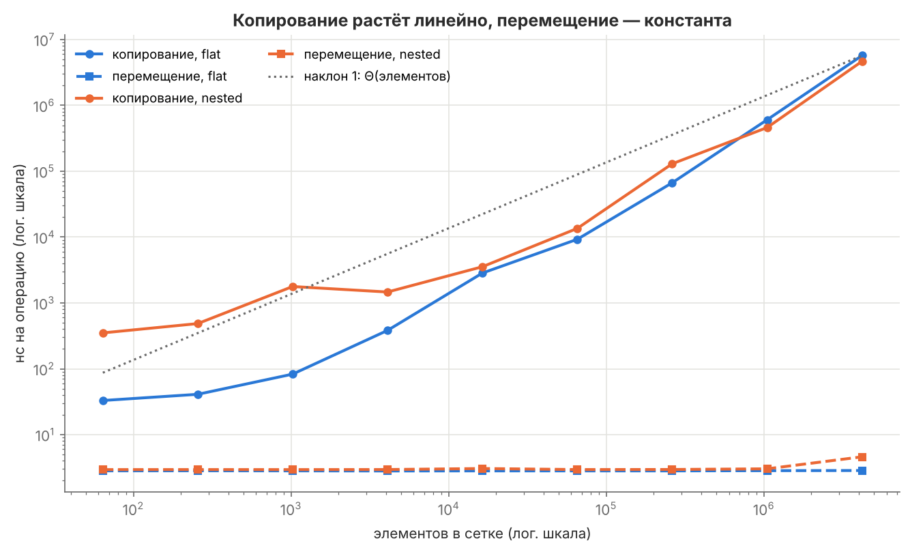
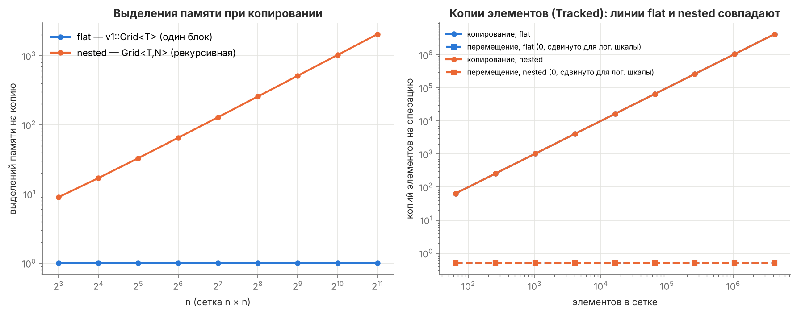
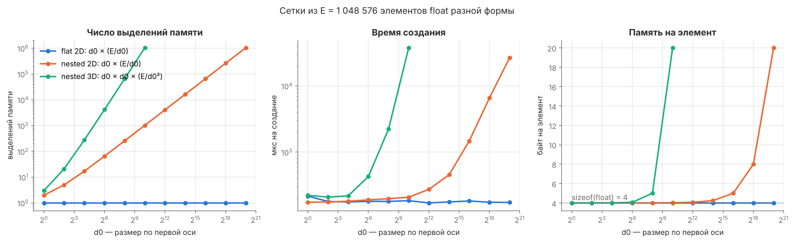
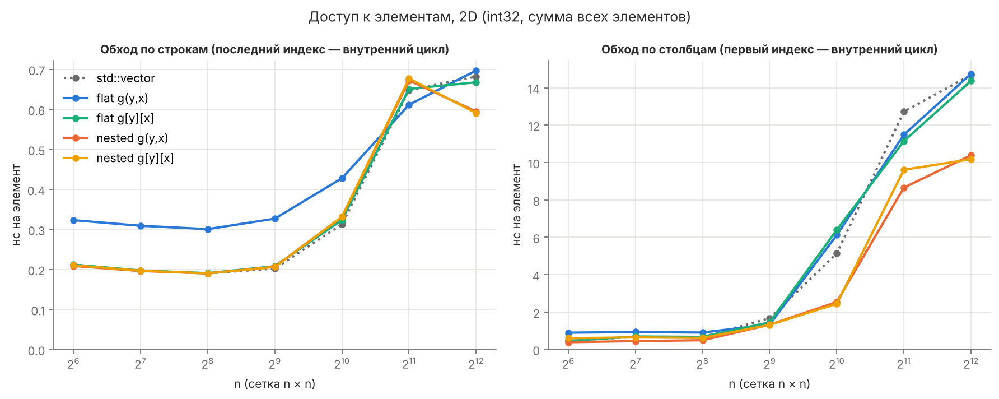
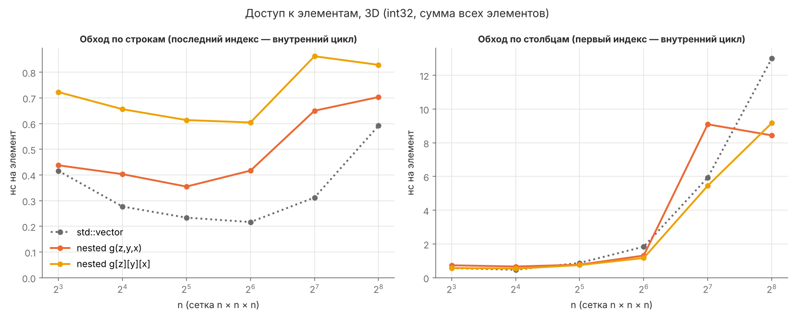

# Отчёт по лабораторной работе «Управление ресурсами»

## 1. Постановка

Исходный шаблон `Grid<T>` хранит указатель на память, выделенную **чужим**
кодом, и освободить её тоже должен чужой код. Копирование и перемещение у
него запрещены (`= delete`). Требуется:

1. сделать так, чтобы сетка сама владела памятью (RAII), и реализовать
   «правило пяти»; добавить конструкторы `Grid(T const&)`,
   `Grid(y, x)` и `Grid(y, x, t)`; сетка должна работать с типами без
   конструктора по умолчанию;
2. добавить оператор индексирования, чтобы работало `g[y][x]`;
3. написать шаблон сетки произвольной размерности `Grid<T, N>`, у которой
   `operator()` принимает ровно N индексов, а `operator[]` возвращает
   ссылку (у неконстантной сетки) или копию (у константной) на сетку
   размерности N−1. Сами сетки должны допускать перемещение.

Дополнительно я сравнил на замерах получившиеся реализации (раздел 4).

## 2. Части 1–2: `grid::v1::Grid<T>`

### 2.1. Что изменено в исходном классе и почему

| Было | Стало | Причина |
|---|---|---|
| `Grid(T* data, ...)` — указатель на чужую память | память выделяется в конструкторе и освобождается в деструкторе | RAII: время жизни ресурса совпадает с временем жизни объекта |
| `T* const data; size_type const y_size, x_size;` | поля без `const` | константное поле нельзя изменить после создания, поэтому были бы невозможны присваивание и перемещение (у перемещённого объекта указатель надо обнулить) |
| копирование и перемещение `= delete` | все пять специальных функций реализованы | «правило пяти»: если классу нужен свой деструктор, то нужны и свои копирование и перемещение. Иначе сгенерированные компилятором версии скопируют указатель, и память освободится дважды |
| `operator=(Grid<T>&)` (без `const`) | `operator=(Grid const&)` | стандартная сигнатура копирующего присваивания |

### 2.2. Правило пяти

```cpp
Grid(Grid const& other);                 // новая память + копии элементов, O(y·x)
Grid(Grid&& other) noexcept;             // забираем указатель, other -> 0×0, O(1)
Grid& operator=(Grid const& other);      // copy-and-swap
Grid& operator=(Grid&& other) noexcept;  // O(1)
~Grid();                                 // разрушить элементы, освободить память
```

* **Глубокое копирование.** Выделяется новый блок, и элементы копируются в
  него по одному. Указатель не копируется, поэтому у двух сеток не бывает
  общей памяти.
* **Перемещение** забирает указатель и размеры, а источнику оставляет
  состояние 0×0. Его деструктор потом ничего не освобождает. Элементы не
  копируются и память не выделяется, поэтому перемещение объявлено
  `noexcept`. Это важно, например, для `std::vector<Grid>`: при росте вектор
  перемещает только те элементы, у которых перемещение не бросает исключений.
* **Копирующее присваивание через copy-and-swap.** Сначала создаётся копия
  во временном объекте (если это бросит исключение, `*this` останется
  нетронутым), затем `*this` обменивается с ней (`swap` не бросает). Старые
  данные освобождает деструктор временного объекта. Получается строгая
  гарантия безопасности исключений, а самоприсваивание работает корректно.

### 2.3. Типы без конструктора по умолчанию

`new T[n]` сразу вызывает `T()` у каждого элемента и не компилируется, если
такого конструктора нет. Поэтому выделение памяти и создание объектов
разделены:

```cpp
T* p = std::allocator<T>{}.allocate(n);    // только память
std::uninitialized_fill_n(p, n, t);        // n копий t прямо в этой памяти
...
std::destroy_n(p, n);                      // разрушить объекты
std::allocator<T>{}.deallocate(p, n);      // вернуть память
```

Если копирование k-го элемента бросит исключение,
`std::uninitialized_fill_n` сам разрушит первые k−1 элементов, а
конструктор освободит память и пробросит исключение дальше. Утечек нет, и
«полусозданных» объектов тоже.

Конструктор (2) `Grid(y, x)` использует `T()`. В шаблоне метод
инстанцируется только при вызове, поэтому для `Grid<Tracked>` (у `Tracked`
нет конструктора по умолчанию) всё компилируется, пока вызывается только
конструктор (3). Элементы в (2) value-инициализируются: для `float`/`int`
это ноль, а при default-инициализации значения были бы неопределёнными.

### 2.4. Конструкторы (1)–(3)

* `Grid(T const& t)` специально объявлен **без** `explicit`: по условию
  нужно неявное преобразование, поэтому работают `Grid<float> g = 2.5f;` и
  вызов функции, принимающей `Grid<float> const&`, с аргументом `float`.
* `g = 3.0f` **не** превращает сетку в 1×1, а заполняет её значением 3.0
  (это `operator=(T const&)` из исходного класса). При перегрузке точное
  совпадение типа побеждает пользовательское преобразование `T → Grid`.

### 2.5. Оператор индексирования `g[y][x]`

`g[y]` возвращает указатель на начало строки y (`data + y·x_size`), а второе
`[x]` — это уже встроенная индексация указателя. Промежуточные объекты не
создаются. У константной сетки возвращается `T const*`, поэтому через неё
элементы изменить нельзя.

## 3. Часть 3: `grid::Grid<T, N>`

### 3.1. Рекурсивное устройство

```
Grid<float,3> g(2, 3, 4)
  data_ ──► [ Grid<float,2> | Grid<float,2> ]
                   │
                   ▼  data_ ──► [ Grid<float,1> × 3 ]
                                      │
                                      ▼  data_ ──► [ float × 4 ]
```

`Grid<T, N>` владеет массивом из `dims[0]` объектов `Grid<T, N−1>`, а
`Grid<T, 1>` — массивом из `dims[0]` элементов `T`. Выбор сделан из-за
требования к `operator[]`. Неконстантная сетка должна возвращать **ссылку**
на сетку меньшей размерности, а ссылку можно вернуть только на объект,
который действительно существует. В рекурсивной схеме подсетки существуют
как настоящие объекты, поэтому:

* `g[1] = другая_сетка;` меняет содержимое `g`;
* `g[i][j][k] = v;` — цепочка ссылок до элемента `T&`;
* у константной сетки `g3[1]` возвращает **копию** `Grid<T, N−1>`. В примере
  из условия `g2 = g3[1]` копия сразу **перемещается** в `g2`, и элементы
  второй раз не копируются.

Каждый уровень — полноценный RAII-класс со своим правилом пяти, поэтому
копирование, перемещение и освобождение рекурсивны «сами по себе»:
`std::uninitialized_copy_n` по массиву подсеток вызывает их копирующие
конструкторы, а `std::destroy_n` — их деструкторы.

Цена такой схемы — много выделений памяти. Её измерения в разделе 4.

### 3.2. Интерфейс и как он проверяется на этапе компиляции

| Возможность | Реализация |
|---|---|
| размерность — параметр шаблона, `N = 2` по умолчанию | `template <typename T, std::size_t N = 2>`, `Grid<int>` — это `Grid<int, 2>` |
| `Grid(d0, …, d{N−1})` | шаблонный конструктор с `requires (sizeof...(Sizes) == N && ...)` |
| `Grid(d0, …, d{N−1}, t)` | `requires sizes_and_value<…>`: первые N аргументов приводятся к `size_type`, последний — к `T` |
| `Grid(T const&)` → 1×…×1 | неявный, разрешён при `N ≥ 2` (при N = 1 запись `Grid<int,1>(5)` была бы неоднозначной: 5 элементов или один элемент 5?) |
| `g(i, j, k)` — ровно N индексов | `requires (sizeof...(Idx) == N)`: при другом числе аргументов ошибка компиляции |
| `g[i]` | `Grid<T,N−1>&` / `Grid<T,N−1>` (при N = 1 — `T&` / `T`) |
| `g.at(...)` | то же, что `g(...)`, но бросает `std::out_of_range` |
| `get_y_size/get_x_size` | есть только при `N == 2` (`requires`) |
| `extents()`, `extent(d)`, `total_size()`, `begin/end` | размеры и обход верхнего уровня |

`operator()` у константной сетки спускается по ссылкам до элемента без
копирования подсеток. Копируется только итоговый элемент, как в исходном
`T operator()(...) const`.

### 3.3. Безопасность исключений при вложенном создании

Если исключение вылетит при создании, например, 11-го элемента во второй
подсетке, нужно разрушить уже созданную первую подсетку и освободить все
выделенные блоки. Для этого служит `detail::ConstructionGuard`: охранник
разрушает созданные объекты и возвращает память в своём деструкторе, если
до конца конструктора не был вызван `release()`. Тест
`nd_exception_safety_in_nested_construction` проверяет, что после такого
исключения не остаётся ни одного живого объекта `Tracked`.

## 4. Тестирование

22 теста (`tests/`). Все проходят в Release, под AddressSanitizer + UBSan
(GCC 13) и при сборке Clang 18. Что проверяется:

* **все три примера кода из текста лабораторной**, без изменений (`assert`
  заменены на `CHECK`), для `v1::Grid` и для `Grid<T, N>`;
* `static_assert`: перемещение `noexcept`; `float` неявно преобразуется в
  `Grid<float>`; `operator[]` возвращает ссылку или копию в зависимости от
  константности; `operator()` нельзя вызвать с числом индексов, отличным от N;
* тип-счётчик `Tracked` без конструктора по умолчанию: число живых объектов
  после разрушения всех сеток равно 0 (утечек нет); перемещение не делает
  ни одной копии элемента;
* исключение на k-м копировании элемента: нет утечек, а присваивание даёт
  строгую гарантию (цель не изменилась);
* копии независимы, самоприсваивание безопасно, перемещённым объектом можно
  пользоваться дальше; пустые сетки; размерность 6; `at()` с выходом за
  границы.

## 5. Исследование

### 5.1. Методика

`grid_bench` (сборка Release, `-O3`) пишет сырые замеры в CSV, их обрабатывает
`python/analyze.py`. Сравниваются:

* **flat** — `grid::v1::Grid<T>`: один непрерывный блок памяти;
* **nested** — `grid::Grid<T, N>`: рекурсивная структура;
* **std::vector** с ручной индексацией `y·n + x` — эталон для доступа.

Время — медиана по 9–21 повтору. Очень быстрые операции (перемещения)
измерялись сериями по 10 000 и делились на 10 000; барьер оптимизатора
(`escape`) не даёт компилятору выбросить цикл. **Число выделений памяти**
считается заменой глобальных `operator new/delete` (`alloc_counter.cpp`),
**число копий элементов** — типом-счётчиком `Tracked`. Обе метрики
машинно-независимы.

Машина: Intel Xeon 2.8 ГГц (облачная ВМ), L1d 32 КБ, L2 1 МБ, L3 33 МБ;
GCC 13.3.

### 5.2. Копирование против перемещения



| Сетка 2048×2048 float (16 МБ) | flat | nested |
|---|---|---|
| копирующий конструктор | 5.7 мс | 4.7 мс |
| перемещающий конструктор | 2.9 нс | 4.6 нс |
| перемещающее присваивание | 1.5 нс | 2.0 нс |
| показатель α для копирования, t ~ (элементов)^α | 1.36 | 1.18 |
| показатель α для перемещения | 0.002 | 0.045 |

* Перемещение работает за **O(1)**: от 4·10³ до 4·10⁶ элементов время
  практически не меняется (α ≈ 0). Для сетки 16 МБ оно в **≈ 2 млн раз**
  быстрее копирования.
* Копирование работает за **Θ(элементов)**. α получился чуть больше 1, потому
  что большие сетки не помещаются в кэш: 64×64 float (16 КБ) копируется из
  L1, а 2048×2048 (16 МБ) упирается в пропускную способность памяти.
  Кроме того, при первом обращении к свежевыделенной большой памяти ОС
  выдаёт страницы через page fault. Это постоянные множители, асимптотику
  они не меняют.



* По счётчику `Tracked` копирование делает ровно `y·x` копий элементов,
  перемещение — **0**, в обеих реализациях.
* Копия flat-сетки — **1** выделение памяти, копия nested-сетки n×n —
  **n + 1** (массив строк + по массиву на строку). Поэтому на маленьких
  сетках nested копируется в ~10 раз медленнее (8×8: 351 нс против 33 нс):
  время уходит на `malloc`, а не на копирование данных.

### 5.3. Цена рекурсивного хранения: выделения памяти



Сетки одного объёма E = 2²⁰ float (4 МБ) разной формы. Измеренное число
выделений **точно** совпадает с формулами ([`check_construct.csv`](../../data/laba_5/check_construct.csv)):

* flat: 1;
* nested 2D (d0 × d1): 1 + d0;
* nested 3D (d0 × d1 × d2): 1 + d0 + d0·d1.

| Форма | Выделений | Байт/элемент* | Создание |
|---|---|---|---|
| flat, любая | 1 | 4.0 | 0.17–0.22 мс |
| nested 1024 × 1024 | 1 025 | 4.02 | 0.21 мс |
| nested 65536 × 16 | 65 537 | 5.0 | 1.5 мс |
| nested 1 048 576 × 1 | 1 048 577 | 20 | 26.9 мс |
| nested 1024 × 1024 × 1 | 1 049 601 | 20 | 37.9 мс |

\* учитываются только запрошенные байты, служебные заголовки `malloc`
(ещё ≥ 8–16 байт на блок) не входят, поэтому реальный расход ещё больше.

Для «квадратных» форм рекурсивная схема почти ничего не стоит. Но когда
последняя ось короткая, на каждые несколько элементов приходится отдельный
объект-подсетка (16 байт: размеры + указатель) и отдельный блок памяти.
Создание тогда замедляется в **≈ 150 раз**, а память растёт в **5 раз**.

### 5.4. Доступ к элементам



Обход с суммированием всех элементов (int32, чтобы компилятор мог
векторизовать сумму):

* **По строкам** все варианты практически равны эталону `std::vector`:
  ≈ 0.2 нс/элемент, пока данные в кэше, и ≈ 0.6–0.7 нс на 4096×4096
  (64 МБ, больше L3). Двойная индексация `g[y][x]` ничего не стоит: компилятор
  выносит адрес строки из внутреннего цикла и векторизует его. Исключение —
  `flat g(y,x)` на малых n (0.32 против 0.21 нс): в этом варианте GCC не
  векторизовал внутренний цикл. Это особенность оптимизатора, а не
  алгоритма.
* **По столбцам** всё в 5–20 раз медленнее, потому что каждый шаг —
  прыжок на целую строку и промах кэша. Интересно, что nested здесь
  **быстрее** плоского массива (n = 1024: 2.5 нс против 5.1–6.4 нс;
  n = 4096: 10.2 против 14.7 нс). Причина в том, что шаг между строками
  плоского массива равен 4096 байт — степени двойки. Все элементы столбца
  попадают в одни и те же наборы (sets) кэша и вытесняют друг друга
  (конфликтные промахи). У nested каждая строка — отдельный блок с
  заголовком `malloc`, шаг получается «некруглым» (4112 байт), и строки
  распределяются по всему кэшу.



В 3D рекурсия уже заметна. При обходе по строкам nested на 19–40 %
медленнее плоского массива (256³: 0.70–0.83 нс против 0.59 нс): на каждый
элемент приходится два уровня косвенной адресации, и векторизация хуже.
При обходе «по столбцам» снова срабатывает эффект некратного шага, и nested
быстрее.

## 6. Выводы

1. Класс `Grid` переведён на **RAII**: память выделяется в конструкторе и
   освобождается в деструкторе. Реализовано **правило пяти**: глубокое
   копирование, перемещение за O(1) (`noexcept`), присваивание через
   copy-and-swap со строгой гарантией. Сетка работает с типами без
   конструктора по умолчанию: память выделяется отдельно от создания
   объектов.
2. `g[y][x]` реализован возвратом указателя на строку: ноль накладных
   расходов, константность сохраняется.
3. `Grid<T, N>` реализован рекурсивно. Это позволяет `operator[]`
   возвращать настоящую ссылку на подсетку (или её копию для константной
   сетки), как требует условие. `operator()` с неверным числом индексов не
   компилируется (ограничения `requires`).
4. Замеры подтверждают, зачем нужна семантика перемещения: копия сетки
   стоит Θ(элементов) (5.7 мс для 16 МБ), перемещение — O(1) (2–5 нс) без
   единой копии элемента и без выделения памяти.
5. Рекурсивное хранение удобно, но не бесплатно: 1 + d0 + d0·d1 + …
   выделений памяти. Для сеток с короткой последней осью создание и
   копирование становятся в десятки–сотни раз дороже, а расход памяти
   растёт в несколько раз. Для доступа к элементам по строкам разницы
   практически нет. Если важна скорость создания и копирования, лучше
   плоское хранение и «облегчённые» подсетки-представления (view), но
   тогда `operator[]` вернёт не ссылку на `Grid`, а отдельный тип
   представления — это расходится с буквой условия.
